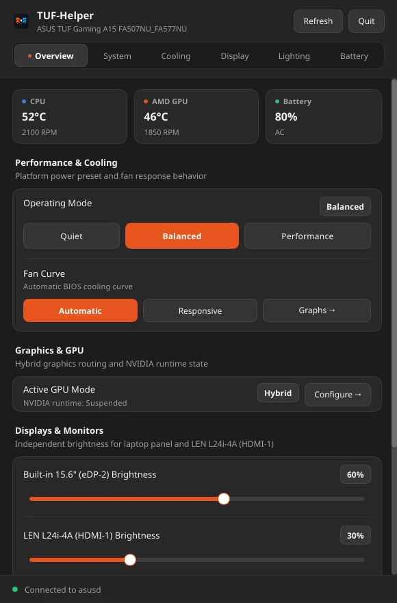
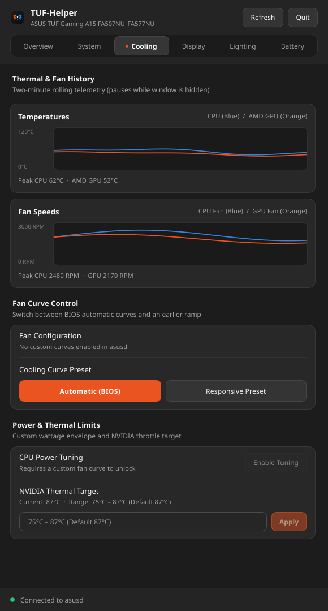
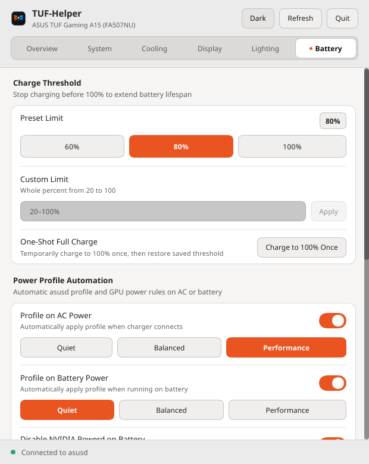
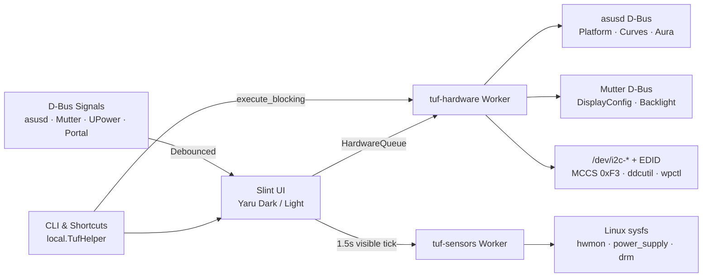

<div align="center">
  
  <h1>TUF-Helper</h1>
  <p>
    <strong>Linux control center for ASUS TUF &amp; ROG laptops and VESA DDC/CI monitors</strong><br />
    Native Rust &amp; Slint desktop app with GNOME Wayland Mutter routing and direct <code>/dev/i2c-*</code> register control
  </p>
  <p>
    <a href="https://github.com/nishantharkut/tuf-helper/actions/workflows/ci.yml"></a>
    <a href="https://github.com/nishantharkut/tuf-helper/releases"></a>
    <a href="LICENSE"></a>
    
  </p>
  <p>
    <a href="#interface-overview">Overview</a> &middot;
    <a href="#screenshots">Screenshots</a> &middot;
    <a href="#tested-hardware-compatibility">Hardware</a> &middot;
    <a href="#measured-performance--comparison">Benchmarks</a> &middot;
    <a href="#architecture">Architecture</a> &middot;
    <a href="#installation">Install</a> &middot;
    <a href="docs/DISPLAY_AND_DDCCI.md">DDC/CI Guide</a>
  </p>
</div>

---

## Interface Overview

<table>
  <tr>
    <td align="center" valign="middle" width="36%">
      
    </td>
    <td valign="middle" width="64%">
      <p><strong>Single-window hardware control with reactive D-Bus updates and Yaru Dark/Light theme sync:</strong></p>
      <ul>
        <li><strong>Dual-Screen Brightness &amp; Auto-Refresh:</strong> Independent laptop backlight (Mutter <code>SetBacklight</code>), external monitor luminance (DDC/CI <code>0x10</code>), multi-monitor selector, and opt-in AC/Battery refresh rate switching.</li>
        <li><strong>VESA MCCS <code>0xF3</code> &amp; Guarded Controls:</strong> Per-EDID capability discovery for color presets (<code>0x14</code>), two-step input switching (<code>0x60</code>), and scaling (<code>0x86</code>), plus contrast, RGB gain, standby (<code>0xD6</code>), rotation, and PipeWire audio.</li>
        <li><strong>ASUS Firmware Tuning (<code>asusd</code>):</strong> Profiles, 8-point CPU/GPU fan curves &amp; responsive preset with rollback, AC/Battery profile &amp; EPP rules, GPU modes, <code>SPL</code>/<code>SPPT</code>/<code>FPPT</code>, NVIDIA boost, Aura RGB, overdrive, charge limit, and <strong>One-Shot 100%</strong>.</li>
        <li><strong>Shortcuts &amp; dGPU Hygiene:</strong> Coalesced D-Bus signals, CLI &amp; <code>local.TufHelper</code> shortcuts (<code>--toggle</code>, <code>--cycle-profile</code>, <code>--step-monitor-brightness</code>), Mesa EGL pinning, and zero-wake <code>/sys/class/drm</code> polling.</li>
      </ul>
    </td>
  </tr>
</table>

### Screenshots

<table>
  <tr>
    <td align="center" width="25%">
      <a href="docs/media/overview.png"></a><br />
      <sub><strong>Overview (Dark)</strong></sub>
    </td>
    <td align="center" width="25%">
      <a href="docs/media/cooling.png"></a><br />
      <sub><strong>Cooling &amp; Telemetry</strong></sub>
    </td>
    <td align="center" width="25%">
      <a href="docs/media/display-controls.png"></a><br />
      <sub><strong>Multi-Display DDC/CI</strong></sub>
    </td>
    <td align="center" width="25%">
      <a href="docs/media/battery-light.png"></a><br />
      <sub><strong>Battery (Yaru Light)</strong></sub>
    </td>
  </tr>
</table>

---

## Tested Hardware Compatibility

| Hardware | OS / Compositor | Daemon / Protocol | Verified Scope |
| --- | --- | --- | --- |
| **ASUS TUF Gaming A15 (`FA507NU`)** | Ubuntu 24.04 LTS (GNOME Wayland) | `asusd 6.5.0` | Profiles, 80%/100% &amp; One-Shot charge, Aura RGB, 8-pt fan curves, SPPT/FPPT/Dynamic Boost, AC/Battery rules |
| **Lenovo `L24i-4A`** (`HDMI-1` / `/dev/i2c-8`) | Ubuntu 24.04 LTS (`i2c-dev`) | `MCCS v2.2` | Brightness (`0x10`), Contrast (`0x12`), Presets (`0x14`), Input (`0x60`), Scaling (`0x86`), 100 Hz switching |

> [!TIP]
> Running another ASUS TUF/ROG laptop or DDC/CI monitor? Share your `cargo run --locked -p tuf-core --example test_hw` output in a [Hardware Compatibility report](https://github.com/nishantharkut/tuf-helper/issues/new/choose) or [Discussions](https://github.com/nishantharkut/tuf-helper/discussions). In GNOME Display Settings, use **Join Displays** (not **Mirror**) for independent per-display refresh rates.

---

## Measured Performance & Comparison

> [!NOTE]
> Local timings were measured in `--release` on an **ASUS TUF Gaming A15 (`FA507NU`)** running **Ubuntu 24.04 LTS (GNOME Wayland)** with a **Lenovo L24i-4A (`HDMI-1` / `/dev/i2c-8`)**.

### Sysfs, D-Bus &amp; DDC/CI Latency

| Operation | Mechanism | Median Latency | Scope |
| --- | --- | --- | --- |
| `NvidiaRuntime::read` | `/sys/class/drm` runtime &amp; connector state | **0.104 ms** (`0.103–0.149 ms`) | 20 runs; keeps D3cold dGPU asleep |
| `BatteryScanner::read_battery` | `/sys/class/power_supply` sysfs | **0.182 ms** (`0.181–0.528 ms`) | 20 runs; %, wattage, limit, health, cycles |
| `DisplayClient::snapshot(false)` | Mutter `DisplayConfig` + panel backlight | **0.907 ms** (`0.833–1.079 ms`) | 5 runs; fast UI pass skips I2C |
| `HwmonScanner::read_sensors` | `hwmon` (`k10temp`, `amdgpu`, `asus`) | **2.390 ms** (`2.190–2.616 ms`) | 20 runs; CPU/GPU temps &amp; fan RPMs |
| `DisplayClient::snapshot(true)` | Cached `/dev/i2c-8` EDID + 7 VCPs + `wpctl` | **480.992 ms** (`478.859–483.391 ms`) | 3 runs; obeys spec `50 ms` VCP delays |
| `ddcutil` CLI (`bus 8` / auto) | Subprocess CLI (`10` or batch `10..1A`) | **130–630 ms** | Single or batch VCP without Mutter/audio |

### Tool Comparison

| Project | Stack | Dual-Screen | External DDC/CI | ASUS Firmware | Tradeoff |
| --- | --- | --- | --- | --- | --- |
| **TUF-Helper** | Rust + Slint (`32 MB`) | Built-in + External | Direct `/dev/i2c-*` + MCCS `0xF3` + `ddcutil` fallback | Profiles, 8-pt curves, AC/Batt rules, GPU, TDP/boost, Aura, battery | Targets GNOME/Mutter for internal panel |
| **asusctl / rog-cc** | Rust + egui (`30 MB`) | No | No | Official `asusd` suite + custom curves | No external DDC/CI or dual brightness |
| **G-Helper** | C# / `.NET` | Windows APIs | Windows monitor APIs | Full Windows ASUS ACPI | Windows-only |
| **ddcutil** | C CLI (`1.5 MB`) | External only | Full VESA MCCS (`130–630 ms`) | No | Subprocess per call; no laptop/ASUS tuning |
| **GNOME Settings** | GNOME / Mutter | Laptop only | No | No | No external monitor or ASUS controls |

---

## Architecture



For threading invariants, `HardwareQueue` coalescing, Portal theme sync, and DDC/CI details, see [`docs/ARCHITECTURE.md`](docs/ARCHITECTURE.md) and [`docs/DISPLAY_AND_DDCCI.md`](docs/DISPLAY_AND_DDCCI.md).

---

## Installation

> [!IMPORTANT]
> Non-root DDC/CI requires kernel module `i2c-dev` and session udev ACLs. On Ubuntu/Debian, `sudo apt install ddcutil` installs `/usr/lib/udev/rules.d/60-ddcutil-i2c.rules`. See [`docs/DISPLAY_AND_DDCCI.md`](docs/DISPLAY_AND_DDCCI.md#setup-for-non-root-ddcci-access).

### Prebuilt Packages (GitHub Releases)

Built on Ubuntu 22.04 for compatibility across Ubuntu 22.04+, Debian 12+, Linux Mint, and Pop!_OS. Download the `.deb`, `.tar.gz`, and `SHA256SUMS` from [GitHub Releases](https://github.com/nishantharkut/tuf-helper/releases):

```sh
# Debian / Ubuntu package
sha256sum -c SHA256SUMS --ignore-missing
sudo apt install ./tuf-gui_*.deb

# Portable tarball
tar -xzf tuf-helper-*-linux-*.tar.gz
./tuf-helper-*/tuf-gui
```

### Build from Source (Ubuntu / Debian)

```sh
sudo apt update
sudo apt install -y build-essential pkg-config libfontconfig1-dev dbus ddcutil
git clone https://github.com/nishantharkut/tuf-helper.git
cd tuf-helper
./scripts/install.sh
```

`install.sh` installs `~/.local/bin/tuf-gui` (stripped), icon, and `.desktop` entry (`--no-build` to reuse an existing binary; `--uninstall` to remove).

<details>
<summary>Manual build, CLI shortcuts, D-Bus actions &amp; hardware diagnostics</summary>

```sh
cargo build --release --workspace --locked
./target/release/tuf-gui

./target/release/tuf-gui --minimized                   # Start hidden in system tray
./target/release/tuf-gui --toggle                      # Toggle window (bindable shortcut)
./target/release/tuf-gui --cycle-profile               # Cycle Quiet / Balanced / Performance
./target/release/tuf-gui --step-monitor-brightness +10 # Step primary external monitor (+/-100)
cargo run --locked -p tuf-core --example test_hw       # Read-only hardware diagnostics
```

When `tuf-gui` is already running, shortcut flags call `Show`, `Toggle`, `CycleProfile`, or `StepMonitorBrightness(i32)` on `local.TufHelper` (`/local/TufHelper`); otherwise `--cycle-profile` and `--step-monitor-brightness` fall back directly to `tuf-core`.

</details>

---

## Verification

All workspace tests run offline against synthetic sysfs trees (`crates/tuf-core/tests/safety.rs`), isolated private `dbus-daemon` buses (`crates/tuf-core/src/dbus/tests.rs`), and headless Slint tests (`crates/tuf-gui`):

```sh
RUSTFLAGS="-D warnings" cargo check --workspace --all-targets --locked
cargo test --workspace --all-targets --locked
cargo doc --workspace --no-deps --locked
```

See [`CONTRIBUTING.md`](CONTRIBUTING.md) for packaging validation (`desktop-file-validate`, `appstreamcli`) and `cargo fmt` / `cargo clippy` checks.

---

## Documentation & License

| File | Description |
| --- | --- |
| [`docs/ARCHITECTURE.md`](docs/ARCHITECTURE.md) | Crate layout, `HardwareQueue`, D-Bus signals, Portal theme sync, and safety invariants |
| [`docs/DISPLAY_AND_DDCCI.md`](docs/DISPLAY_AND_DDCCI.md) | Multi-display discovery, MCCS `0xF3` caching, EEPROM dedup, VCP map, and `i2c-dev` setup |
| [`CONTRIBUTING.md`](CONTRIBUTING.md) | Coding conventions, fixture testing rules, and CI verification checklist |
| [`SECURITY.md`](SECURITY.md) | Unprivileged security boundary and vulnerability reporting |
| [`CHANGELOG.md`](CHANGELOG.md) | Release notes following Keep a Changelog |

Built with ideas and Linux D-Bus specifications pioneered by [G-Helper](https://github.com/seerge/g-helper), [asusctl / asusd](https://gitlab.com/asus-linux/asusctl), [Slint](https://slint.dev/), and [ddcutil](https://www.ddcutil.com/). Licensed under [`GPL-3.0-or-later`](LICENSE).
