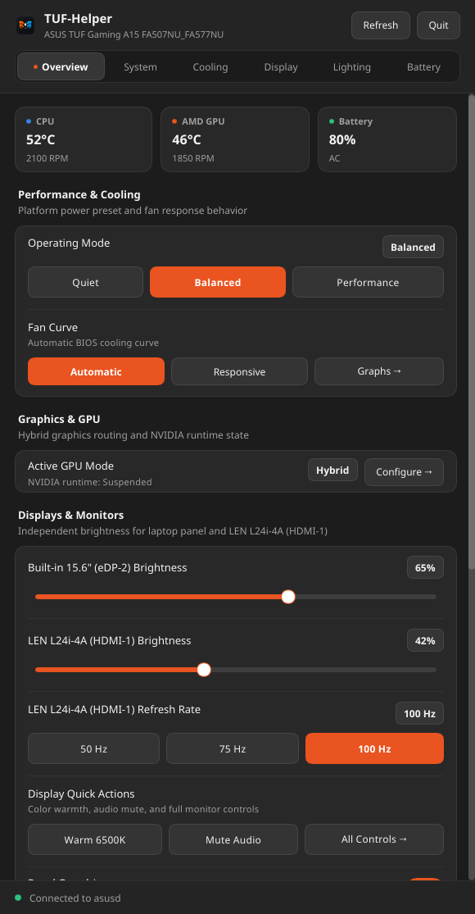
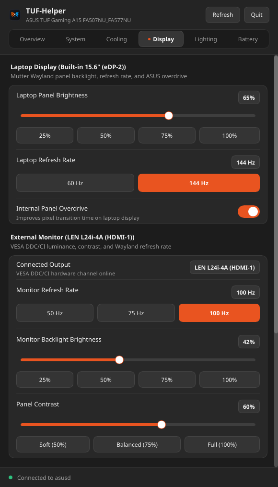
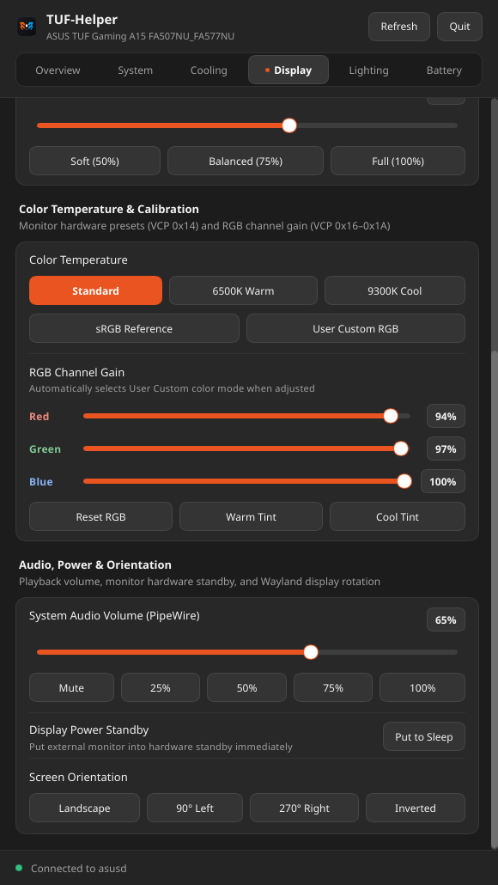
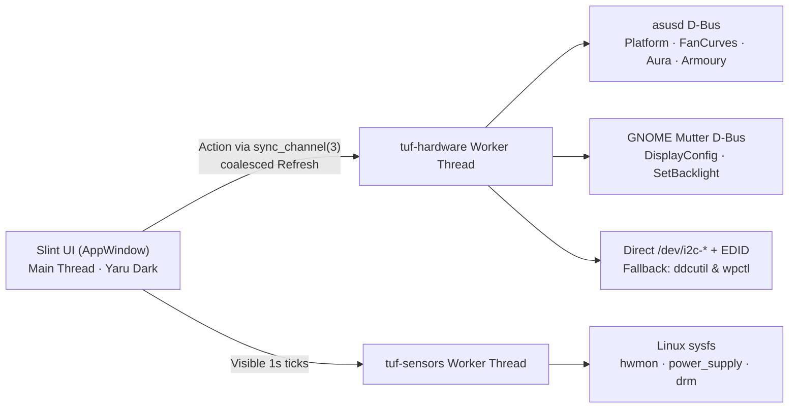

<div align="center">
  
  <h1>TUF-Helper</h1>
  <p>
    <strong>Linux control center for ASUS TUF &amp; ROG laptops and VESA DDC/CI monitors</strong><br />
    Written in Rust &amp; Slint with native Wayland Mutter display routing and direct <code>/dev/i2c-*</code> register control
  </p>
  <p>
    <a href="https://github.com/nishantharkut/tuf-helper/actions/workflows/ci.yml"></a>
    <a href="LICENSE"></a>
    
    
    
  </p>
  <p>
    <a href="#interface-overview">Interface</a> &middot;
    <a href="#measured-performance--comparison">Benchmarks</a> &middot;
    <a href="#architecture">Architecture</a> &middot;
    <a href="#installation">Install</a> &middot;
    <a href="docs/DISPLAY_AND_DDCCI.md">DDC/CI Guide</a> &middot;
    <a href="docs/ARCHITECTURE.md">Design Docs</a>
  </p>
</div>

---

## Interface Overview

<table>
  <tr>
    <td align="center" valign="top" width="38%">
      
    </td>
    <td valign="top" width="62%">
      <p><strong>Compact single-window hardware control built for low idle overhead:</strong></p>
      <ul>
        <li><strong>Dual-Display Brightness &amp; Hz:</strong> Independently controls internal laptop backlight (Mutter <code>SetBacklight</code>, 5–100%) and external monitor backlight (DDC/CI <code>0x10</code>, 0–100%) in both Extended and Mirror modes.</li>
        <li><strong>Monitor Calibration &amp; Power:</strong> Contrast (<code>0x12</code>), verified <code>0x14</code> color presets, Red/Green/Blue channel gains (<code>0x16/0x18/0x1A</code>), DPMS standby (<code>0xD6</code>), Wayland rotation, and PipeWire (<code>wpctl</code>) audio fallback.</li>
        <li><strong>ASUS Firmware Tuning (<code>asusd</code>):</strong> Power profiles, responsive dual fan curves with failure rollback, Hybrid/Eco/Ultimate GPU mode queueing, CPU sustained SPL limit, NVIDIA thermal target, Aura lighting, overdrive, and battery charge threshold (20–100%).</li>
        <li><strong>dGPU Power Hygiene:</strong> Pins Mesa EGL (<code>50_mesa.json</code>) on AMD iGPU systems and inspects <code>/sys/class/drm</code> without waking a sleeping NVIDIA dGPU.</li>
      </ul>
    </td>
  </tr>
</table>

<details>
<summary>View individual tab screenshots (Overview, Cooling Telemetry, Display Controls, Calibration)</summary>
<br />
<table>
  <tr>
    <td align="center" width="25%">
      <br />
      <sub><strong>Overview</strong></sub>
    </td>
    <td align="center" width="25%">
      <br />
      <sub><strong>Cooling &amp; Telemetry</strong></sub>
    </td>
    <td align="center" width="25%">
      <br />
      <sub><strong>Display Hardware</strong></sub>
    </td>
    <td align="center" width="25%">
      <br />
      <sub><strong>Calibration &amp; Audio</strong></sub>
    </td>
  </tr>
</table>
</details>

---

## Measured Performance & Comparison

> [!NOTE]
> All local timings below were measured directly in `--release` on an **ASUS TUF Gaming A15 (`ASUS-TUF-Laptop`)** running **Ubuntu 24.04 LTS (GNOME Wayland)** connected to a **External MCCS Monitor (`HDMI-1` / `/dev/i2c-*`)**. Unmeasured external platforms list architectural scope only.

### Local Sysfs, D-Bus & DDC/CI Latency

| Operation | Mechanism | Measured Latency | Scope & Behavior |
| --- | --- | --- | --- |
| `NvidiaRuntime::read` | `/sys/class/drm` runtime status & connector state | **0.104 ms** median (`0.103–0.149 ms`) | 20 runs; keeps D3cold dGPU suspended |
| `BatteryScanner::read_battery` | `/sys/class/power_supply` sysfs | **0.182 ms** median (`0.181–0.528 ms`) | 20 runs; charge %, wattage, limit, health, cycles |
| `DisplayClient::snapshot(false)` | Mutter `DisplayConfig` D-Bus + panel backlight | **0.907 ms** median (`0.833–1.079 ms`) | 5 runs; fast UI refresh skips blocking I2C reads |
| `HwmonScanner::read_sensors` | Linux `hwmon` (`k10temp`, `amdgpu`, `asus`) | **2.390 ms** median (`2.190–2.616 ms`) | 20 runs; CPU, AMD GPU, CPU/GPU fan RPMs |
| `DisplayClient::snapshot(true)` | Cached `/dev/i2c-*` EDID + 7 VCP reads + `wpctl` | **480.992 ms** median (`478.859–483.391 ms`) | 3 runs; obeys spec `50 ms` VCP delays in worker |
| `ddcutil getvcp 10 --brief` | Subprocess CLI with I2C bus auto-detection | **630 ms** (`0.63 s` real) | Single register read per process spawn |
| `ddcutil --bus 8 getvcp 10 --brief` | Subprocess CLI with pinned bus index | **130 ms** (`0.13 s` real) | Single register read |
| `ddcutil --bus 8 getvcp 10 12 14 16 18 1A` | Subprocess CLI batch read | **200 ms** (`0.20 s` real) | Without Mutter backlight, PipeWire, or dual state |

### Tool Comparison

| Project | Stack & Local Binary | Dual-Screen Brightness | External Monitor DDC/CI | ASUS Firmware Controls | Tradeoffs |
| --- | --- | --- | --- | --- | --- |
| **TUF-Helper** | Rust + Slint (`29 MB` stripped, `13` `ldd` entries) | Built-in (`Mutter`) + External (`DDC/CI`) simultaneously | Direct `/dev/i2c-*` + EDID match + `ddcutil` fallback (`0x10/12/14/16/18/1A/62/8D/D6`) | Profiles, curves w/ rollback, GPU, SPL, NV target, Aura, overdrive, battery | Targets GNOME/Mutter for internal backlight/Hz |
| **asusctl / rog-control-center** | Rust + egui (`30 MB` binary, `14` `ldd` entries) | No | No | Official `asusd` suite + full custom fan curve editor | No external display DDC/CI or dual brightness |
| **G-Helper** | C# / `.NET` (Windows) | Windows APIs + limited DDC | Windows vendor/monitor APIs | Full Windows ASUS ACPI integration | Windows-only |
| **ddcutil CLI / extensions** | C CLI (`1.5 MB` binary) | External monitor only | Full VESA MCCS via CLI (`130–630 ms` per call) | No | Spawns subprocesses; no laptop panel or ASUS tuning |
| **GNOME Quick Settings** | GNOME Shell / Mutter | Laptop panel only | No | No | No external brightness/RGB or ASUS hardware controls |

---

## Architecture



Read the full threading, safety invariants, and DDC/CI register protocol breakdown in [`docs/ARCHITECTURE.md`](docs/ARCHITECTURE.md) and [`docs/DISPLAY_AND_DDCCI.md`](docs/DISPLAY_AND_DDCCI.md).

---

## Installation

> [!IMPORTANT]
> For external monitor DDC/CI without root, ensure kernel module `i2c-dev` is loaded and session ACL rules are installed (on Ubuntu/Debian, `sudo apt install ddcutil` provides `/usr/lib/udev/rules.d/60-ddcutil-i2c.rules`). See [`docs/DISPLAY_AND_DDCCI.md`](docs/DISPLAY_AND_DDCCI.md#setup-for-non-root-ddcci-access).

### Build Dependencies (Ubuntu / Debian)

```sh
sudo apt update
sudo apt install -y build-essential pkg-config libfontconfig1-dev dbus ddcutil
```

### User-Local Install (Binary, Icon & Desktop Entry)

```sh
git clone https://github.com/nishantharkut/tuf-helper.git
cd tuf-helper
./scripts/install.sh
```

Installs `~/.local/bin/tuf-gui` (stripped), `~/.local/share/icons/hicolor/scalable/apps/tuf-helper.svg`, and `~/.local/share/applications/tuf-helper.desktop` (`StartupWMClass=tuf-helper`). Pass `--uninstall` to remove them cleanly.

<details>
<summary>Manual build, tray flags &amp; read-only diagnostics</summary>

```sh
# Build and launch directly
cargo build --release --workspace --locked
./target/release/tuf-gui

# Launch minimized to the SNI system tray (single-instance session lock via local.TufHelper)
./target/release/tuf-gui --minimized

# Run read-only hardware diagnostics (asusd, hwmon, battery, DRM runtime)
cargo run --locked -p tuf-core --example test_hw
```

</details>

---

## Verification

All tests run offline against synthetic sysfs trees (`crates/tuf-core/tests/safety.rs`) and isolated private `dbus-daemon` buses (`crates/tuf-core/src/dbus/tests.rs`) — zero host hardware mutations occur during test runs:

```sh
RUSTFLAGS="-D warnings" cargo check --workspace --all-targets --locked
cargo test --workspace --all-targets --locked
cargo doc --workspace --no-deps --locked
```

> [!TIP]
> In GNOME Display Settings, **Mirror** mode locks independent per-display refresh rates at the compositor level. Use **Join Displays** to switch laptop (`eDP`) and external monitor (`HDMI`/`DP`) refresh rates separately.

---

## Documentation & Policies

| File | Description |
| --- | --- |
| [`docs/ARCHITECTURE.md`](docs/ARCHITECTURE.md) | Crate layout, worker threading, Mesa EGL isolation, and hardware safety invariants |
| [`docs/DISPLAY_AND_DDCCI.md`](docs/DISPLAY_AND_DDCCI.md) | Dual-display discovery, DDC/CI frame hardening, VCP map, and `i2c-dev` troubleshooting |
| [`CONTRIBUTING.md`](CONTRIBUTING.md) | Coding conventions, fixture testing rules, and verification checklist |
| [`SECURITY.md`](SECURITY.md) | Unprivileged security boundary and vulnerability reporting |
| [`CHANGELOG.md`](CHANGELOG.md) | Release notes following Keep a Changelog |

---

## Acknowledgments & License

Built with ideas and Linux D-Bus specifications pioneered by [G-Helper](https://github.com/seerge/g-helper), [asusctl / asusd](https://gitlab.com/asus-linux/asusctl), [Slint](https://slint.dev/), and [ddcutil](https://www.ddcutil.com/).

Licensed under the [**GNU General Public License v3.0 or later (`GPL-3.0-or-later`)**](LICENSE).
