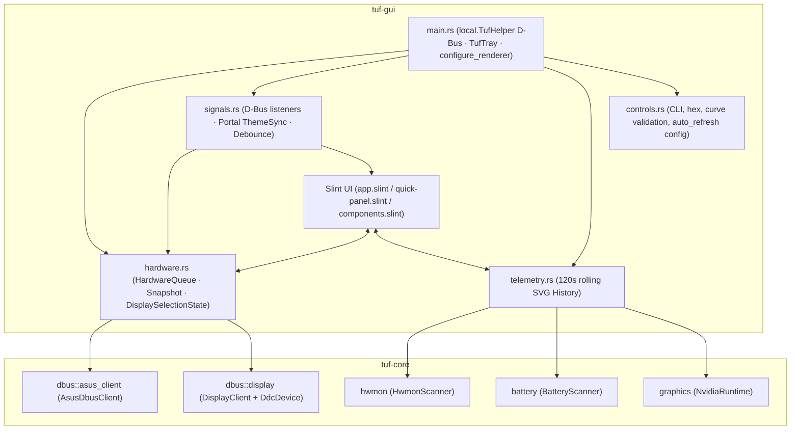

# Architecture

TUF-Helper separates hardware access and desktop rendering across two workspace crates:

---

## Concurrency, `HardwareQueue` & Reactive Signals

`tuf-gui` coordinates UI rendering, hardware writes, sensor polling, and reactive D-Bus listeners across dedicated contexts (`crates/tuf-gui/src/`):

1. **Main UI Thread (Slint / winit):**
   - Renders `AppWindow`, hosts the `local.TufHelper` session D-Bus service (`/local/TufHelper` exporting `Show`, `Toggle`, `CycleProfile`, and `StepMonitorBrightness(i32)`), and manages the `ksni` SNI system tray (`TufTray`).
   - Uses draft properties (`builtin_bri_draft`, `display_bri_draft`, `contrast_draft`, `rgb_*_draft`, `display_vol_draft`) so slider drags remain fluid while hardware writes commit on pointer release (`released(v)`).
   - Runs two visibility-gated `slint::Timer`s: a `1500 ms` sensor sample trigger (`tuf-sensors` via `sync_channel(1)`) and a `5 s` fallback fast poll trigger (`request_poll()` only when visible, not `busy`, and not `refreshing`). Both pause automatically when the window is hidden.

2. **Hardware Worker & `HardwareQueue` (`hardware.rs`):**
   - `HardwareQueue` (`Arc<(Mutex<QueueState>, Condvar)>`) separates queued commands (`actions: VecDeque<QueuedAction>`, bounded by `MAX_QUEUED_ACTIONS = 16`) from coalesced refresh state (`pending_refresh: Option<RefreshKind>` and `refresh_in_flight: Option<RefreshKind>`).
   - **Priority & Coalescing:** `next_work()` always drains queued actions FIFO before considering `shutdown` or `pending_refresh`. `request_full_refresh()` merges via `RefreshKind::merge` (`Fast` + `Full` upgrades to `Full`, never downgrading) so `MonitorsChanged` or explicit Refresh events are never dropped while `busy` or `refreshing`.
   - **`Poll` (`RefreshKind::Fast`) vs `Full` (`RefreshKind::Full`):**
     - `Full` (`snapshot(true)`) reads `asusd`, Mutter `DisplayConfig`, `/dev/i2c-*` DDC/CI registers, MCCS `0xF3` capabilities (per-EDID cached), and PipeWire (`wpctl`) audio status.
     - `Poll` (`request_poll()` / `snapshot(false)`) skips blocking I2C DDC reads. `request_poll()` is a no-op whenever `shutdown` is set, a refresh is already in flight or pending, or user actions are queued, preventing slow DDC backlogs.
     - `merge_display_snapshot` preserves previously polled DDC fields inside `DisplaySelectionState` across fast `Poll` updates **only** when connector `id` and EDID (`edid_vendor`, `edid_model`, `edid_serial`) still match, preventing stale registers from leaking onto a newly swapped monitor.
   - **`execute_blocking(action, timeout)`:** Attaches a `sync_channel(1)` reply sender to `QueuedAction` so D-Bus shortcut methods (`CycleProfile`, `StepMonitorBrightness`) wait synchronously up to `12 s` for confirmed `ActionOutcome` (`Done`, `Profile`, `Brightness`) or real hardware error messages. On worker exit, `queue.close()` clears state and notifies waiters so blocking callers fail promptly instead of deadlocking.
   - **Hidden Error Visibility:** If an action fails while the window is hidden (`--minimized`), `hardware::run` reveals the window (`app.show()`) and triggers `refresh_requested()` so the error status is visible immediately.

3. **Reactive D-Bus Signal Listeners (`signals.rs`):**
   - `signals::spawn` starts five listener threads plus a debounced dispatcher (`SignalHandle` + `SignalStop` condvar for clean shutdown):
     - `tuf-sig-asus`: system bus `org.freedesktop.DBus.Properties.PropertiesChanged` under path namespace `/xyz/ljones` (`RefreshKind::Fast`).
     - `tuf-sig-upower`: system bus `org.freedesktop.DBus.Properties.PropertiesChanged` on `/org/freedesktop/UPower` (`RefreshKind::Fast` + `power = true`).
     - `tuf-sig-mutter`: session bus `org.gnome.Mutter.DisplayConfig.MonitorsChanged` (`RefreshKind::Full`).
     - `tuf-sig-backlight`: session bus `org.freedesktop.DBus.Properties.PropertiesChanged` on `/org/gnome/Mutter/DisplayConfig` (`RefreshKind::Fast`).
     - `tuf-sig-portal`: session bus `org.freedesktop.portal.Settings.SettingChanged` on `/org/freedesktop/portal/desktop`.
   - **Burst Debouncing (`tuf-sig-dispatch`):** `collect_burst` merges rapid consecutive signals over a `180 ms` debounce window (`DEBOUNCE_WINDOW`) capped at `500 ms` (`MAX_DEBOUNCE_WAIT`). When the window is hidden, non-power signals are skipped; `UPower` events still trigger `request_poll()` if opt-in `auto_refresh` is enabled and `!busy`.
   - **Exponential Backoff Reconnect:** Both `run_listener` and `listen_portal_theme` recover from bus/stream disconnects with backoff starting at `RECONNECT_INITIAL = 500 ms`, doubling up to `RECONNECT_MAX = 10 s` (interruptible via `SignalStop`). After reconnect, listeners emit a catch-up refresh or re-read portal theme state.

4. **Sensor Telemetry Worker (`tuf-sensors` thread):**
   - Polls sysfs `hwmon`, `power_supply`, and DRM attributes on demand from the visibility-gated `1500 ms` timer.
   - Maintains a 120-second `History` ring buffer (`MAX_SAMPLES = 121`) emitting SVG path strings (`360 x 80` viewbox) for real-time temperature and fan RPM charts in the **Cooling** tab.

---

## Theme Polarity & Portal Light/Dark Sync

`Yaru` in `crates/tuf-gui/ui/components.slint` defines full opaque Yaru Dark and Yaru Light token sets controlled by `Yaru.dark-mode` and mirrored to Slint's `Palette.color-scheme` (`ColorScheme.dark` / `ColorScheme.light`):

1. On startup, `signals::read_portal_dark_mode()` queries `org.freedesktop.portal.Settings` (`org.freedesktop.appearance`, `color-scheme`) via `ReadOne` with `Read` fallback and a `500 ms` timeout (`2 => light`, `0 | 1 | fallback => dark`).
2. During execution, `listen_portal_theme` processes live `SettingChanged` signals through `ThemeSync`.
3. If the user manually toggles the theme in-session (via the header `Light`/`Dark` button or the Battery tab `Dark Theme` switch), `ThemeSync` detects `current_ui_dark != last_portal_dark`, sets `overridden = true`, and stops applying portal theme updates for the rest of the session.

---

## Renderer & dGPU Power Hygiene

> [!NOTE]
> On hybrid AMD + NVIDIA laptops, opening an OpenGL desktop window through GLVND defaults can wake the discrete NVIDIA GPU simply to render GUI frames.

To avoid unnecessary dGPU wakeups, `configure_renderer()` in `crates/tuf-gui/src/main.rs`:
1. Honors any user-supplied `SLINT_BACKEND` environment override.
2. Scans `/sys/class/drm/card*` for an AMD vendor ID (`0x1002`).
3. When an AMD iGPU and `/usr/share/glvnd/egl_vendor.d/50_mesa.json` are present, pins `__EGL_VENDOR_LIBRARY_FILENAMES` to Mesa and launches `SLINT_BACKEND=winit` (hardware-accelerated on the integrated GPU).
4. Falls back to `SLINT_BACKEND=winit-software` when Mesa EGL or an AMD iGPU is absent.

Similarly, `NvidiaRuntime::read()` inspects sysfs (`/sys/class/drm/card*/device/power/runtime_status` and connector `enabled` files) instead of invoking `nvidia-smi` or NVML, preserving `Suspended` D3cold idle states.

---

## Hardware Contracts & Safety Invariants

- **No silent startup writes:** Opening TUF-Helper is strictly read-only. Firmware profiles, fan curves, CPU/GPU power limits, brightness, Aura lighting, and display registers are only modified on explicit user action. Opt-in AC/Battery laptop auto-refresh (`${XDG_CONFIG_HOME:-$HOME/.config}/tuf-helper/auto_refresh`) defaults to `false` and only switches Mutter refresh rates (`high` on AC, `low` on Battery) when enabled, unmirrored, `low > 0 && high > low`, `cur != target`, and once per `(auto_refresh_epoch, ac_online)` transition.
- **Extended `AsusArmoury` bounds (`asus_client.rs`):**
  - Supports `ppt_pl1_spl` (SPL), `ppt_pl2_sppt` (SPPT), `ppt_pl3_fppt` (FPPT), `nv_temp_target` (NVIDIA thermal target), and `nv_dynamic_boost` (NVIDIA Dynamic Boost) under `/xyz/ljones/asus_armoury/<attr>`.
  - `tuning_bounds` requires `MinValue >= 0`, `MaxValue >= MinValue`, and `DefaultValue >= MinValue`, clamping writable values to `MinValue..=MaxValue.min(DefaultValue)` — never exceeding firmware `DefaultValue`.
  - `ppt_pl1_spl`, `ppt_pl2_sppt`, and `ppt_pl3_fppt` require `EnablePptGroup == true` and kernel `asus_custom_fan_curve` hwmon `[pwm1_enable, pwm2_enable] == [1, 1]`; `ppt_pl1_spl` also enforces `watts <= ppt_pl2_sppt.CurrentValue`. Missing D-Bus objects map to explicit device-unavailable errors, and all writes verify readback via `confirmed(...)`.
- **Fan-curve safety invariants (`AsusDbusClient` & `controls.rs`):**
  - Both the responsive preset (`set_responsive_fans`) and custom 8-point curves (`set_custom_fan_curves`, `FanCurveProfile`) validate `profile` in `0..=3`, non-empty unique fan names matching all system fans from `FanCurveData(profile)`, monotonic non-decreasing PWM (`0..=255`, UI `0–100%`), monotonic non-decreasing temperatures (`<= 110°C` backend; UI grid steppers `30–105°C`), `PlatformProfile == profile`, `!ppt_enabled()?`, and matching kernel `asus_custom_fan_curve` hwmon modes (`[1, 1]` or `[2, 2]`).
  - `apply_fan_curves_atomically` stages every curve with `enabled = false` via `SetFanCurve`, re-verifies `PlatformProfile`, enables curves (`SetFanCurvesEnabled(profile, true)`), verifies readback of all points and `enabled == true`, re-verifies `PlatformProfile`, and confirms kernel hwmon `[1, 1]`. On any failure, it rolls back via `SetFanCurvesEnabled(profile, false)`, restores prior curves disabled, and checks kernel `[2, 2]` BIOS auto mode.
  - `reset_fan_curves_to_defaults(profile)` rejects active PPT tuning on the active profile, calls `SetCurvesToDefaults(profile)` + `SetFanCurvesEnabled(profile, false)`, confirms `enabled == false`, and verifies `[2, 2]` when resetting the active profile.
- **Battery & AC/Battery automation (`xyz.ljones.Platform`):**
  - `one_shot_full_charge` invokes `OneShotFullCharge()`; `set_charge_limit` validates `20..=100%` and skips no-op writes.
  - `PlatformAutomationState` reads/writes `ChangePlatformProfileOnAc`, `ChangePlatformProfileOnBattery`, `PlatformProfileOnAc`, `PlatformProfileOnBattery`, `DisableNvidiaPowerdOnBattery`, and `PlatformProfileLinkedEpp`, validating profile targets against `PlatformProfileChoices` (with `2 -> 3` LowPower fallback) and confirming readback.
- **GPU transition rules:** Switching between **Eco** and **Ultimate** routes through **Hybrid**. **Eco** is rejected whenever NVIDIA DRM outputs report active displays (`nvidia_outputs != "None enabled"`).
- **Testing without hardware mutation:**
  - `crates/tuf-core/src/dbus/tests.rs` spawns an isolated private `dbus-daemon` via `tempfile::TempDir` to verify `Platform`, `FanCurves`, `Aura`, and `AsusArmoury` contracts end-to-end.
  - `crates/tuf-core/tests/safety.rs` tests sysfs `hwmon` and `power_supply` parsers using synthetic fixture directories.
  - `crates/tuf-core/src/dbus/display.rs` tests EDID parsing, cached EDID validation, MCCS `0xF3` chunked capabilities assembly and parsing, EEPROM write deduplication (`MockVcpTransport`), VCP frame decoding, and multi-monitor Mutter `CurrentState` planning.
  - `crates/tuf-gui` tests queue coalescing, blocking shutdown behavior, `ThemeSync` overrides, debounce caps, fan-curve PWM/point validation, CLI parsing, and headless `AppWindow` callbacks (`i-slint-backend-testing`).
