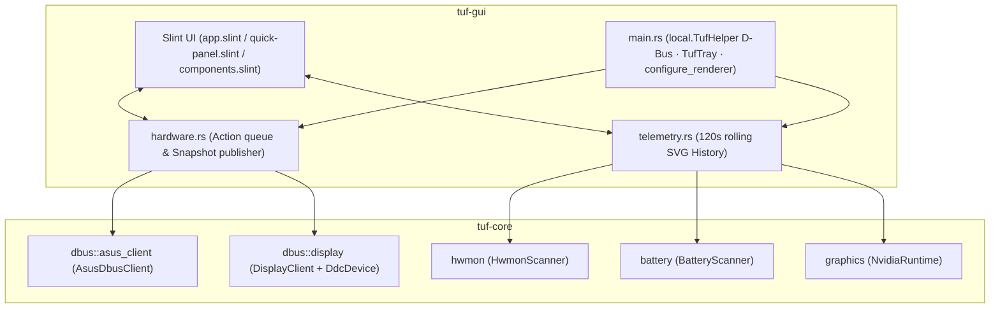

# Architecture

TUF-Helper separates hardware access and desktop rendering across two workspace crates:

---

## Concurrency & Threading Model

`tuf-gui` runs three dedicated execution contexts (`crates/tuf-gui/src/main.rs`):

1. **Main UI Thread (Slint / winit):**
   - Renders `AppWindow`, handles user input, and dispatches queued commands without blocking on D-Bus or I2C timeouts.
   - Employs draft properties (`builtin_bri_draft`, `display_bri_draft`, `contrast_draft`, `rgb_*_draft`, `display_vol_draft`) so dragging sliders stays smooth while hardware writes commit asynchronously on pointer release (`released(v)`).
2. **Hardware Command Worker (`tuf-hardware` thread):**
   - Receives `hardware::Action` variants over a bounded `sync_channel(3)`.
   - Coalesces pending `Action::Refresh` requests so a user action queued while a refresh is running is never dropped (`clicking_a_charge_limit_during_refresh_queues_one_change`).
   - Serializes all writes to `asusd`, `org.gnome.Mutter.DisplayConfig`, PipeWire (`wpctl`), and `/dev/i2c-*` DDC/CI devices.
3. **Sensor Telemetry Worker (`tuf-sensors` thread):**
   - Polls sysfs `hwmon`, `power_supply`, and DRM attributes every second while the window is visible, pausing automatically while minimized to the tray.
   - Maintains a 120-second `History` ring buffer (`MAX_SAMPLES = 121`) emitting SVG path strings (`360 x 80` viewbox) for real-time temperature and fan RPM charts in the **Cooling** tab.

---

## Renderer & dGPU Power Hygiene

> [!NOTE]
> On hybrid AMD + NVIDIA laptops (such as ASUS-TUF-Laptop/ASUS-TUF-Laptop), opening an OpenGL desktop window through GLVND defaults can wake the discrete NVIDIA GPU simply to render GUI frames.

To avoid unnecessary dGPU wakeups, `configure_renderer()` in `crates/tuf-gui/src/main.rs`:
1. Honors any user-supplied `SLINT_BACKEND` environment override.
2. Scans `/sys/class/drm/card*` for an AMD vendor ID (`0x1002`).
3. When an AMD iGPU and `/usr/share/glvnd/egl_vendor.d/50_mesa.json` are present, pins `__EGL_VENDOR_LIBRARY_FILENAMES` to Mesa and launches `SLINT_BACKEND=winit` (hardware-accelerated on the integrated GPU).
4. Falls back to `SLINT_BACKEND=winit-software` when Mesa EGL or an AMD iGPU is absent.

Similarly, `NvidiaRuntime::read()` inspects sysfs (`/sys/class/drm/card*/device/power/runtime_status` and connector `enabled` files) instead of invoking `nvidia-smi` or NVML, preserving `Suspended` D3cold idle states.

---

## Hardware Contracts & Safety Invariants

- **No silent startup writes:** Opening TUF-Helper is strictly read-only. Platform profiles, custom fan curves, CPU power limits, brightness, and RGB settings are only modified upon explicit user interaction.
- **Dual fan curve atomicity (`AsusDbusClient`):** Enabling the responsive preset writes both CPU and GPU fan curves, verifies kernel fan curve activation, and attempts to restore previous curves if the second write or confirmation fails.
- **GPU transition rules:** Switching between **Eco** and **Ultimate** routes through **Hybrid**. **Eco** is disabled in the UI whenever NVIDIA DRM outputs report active displays (`nvidia_outputs != "None enabled"`).
- **Testing without hardware mutation:**
  - `crates/tuf-core/src/dbus/tests.rs` spawns an isolated private `dbus-daemon` via `tempfile::TempDir` to test `asusd` property/curve contracts end-to-end.
  - `crates/tuf-core/tests/safety.rs` tests sysfs `hwmon` and `power_supply` parsers using synthetic fixture directories.
  - `crates/tuf-core/src/dbus/display.rs` tests EDID parsing, VCP frame decoding/checksums/null-frames, percentage scaling, and dual-display Mutter `CurrentState` planning in both Extended and Mirror configurations.
